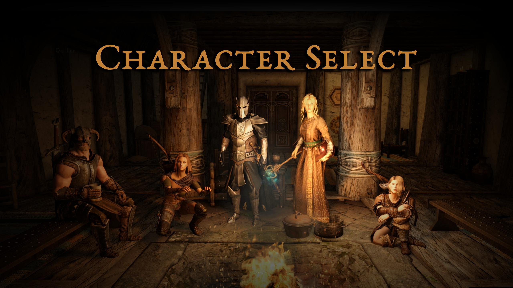

# Character Select



An SKSE plugin that swaps Skyrim's main menu for a lobby with the characters from your saves. Pick one, press **Enter**, and it loads their latest save.

**Download:** [Nexus Mods](https://www.nexusmods.com/skyrimspecialedition/mods/198132), or the [GitHub releases](https://github.com/mattski5543/skse_charselect/releases).

## Features

- Your latest saves become characters in the lobby, including their equipment, overlays etc.
- Changing your look with RaceMenu during play keeps you the same character. The game would otherwise start a new character every time, so you'd show up twice (`bKeepCharacterAfterRaceMenu = 0` for the game's own way). Characters split before 1.1.0 stay split. This fix is also planned as a separate mod, for anyone who wants it without the lobby.
- In-game editor (F8) to set the position and pose of each character, and the camera.
- 5 pre-configured scenes to choose from. Any named cell can become a lobby once it's set up ([how](docs/CUSTOM_LOBBY.md)).
- Characters can use furniture and play animations. They're locked in place once set up.
- Keyboard, mouse and controller support.
- No `.esp`, and it never touches your save files. See [save safety](docs/SAVE_SAFETY.md).

## How it works

- Character Select records each character's look whenever you load or save, including their RaceMenu preset and gear.
- As soon as the main menu would normally load, it does a `coc` into the location set in your config. That essentially starts a new game.
- Each recorded character is spawned there as a temporary NPC, and the NPCs who'd normally be there are hidden. Saving and normal character controls are switched off while you're in the lobby.
- Pick a character with the arrow keys and press **Enter** to load their latest save.
- Once a save loads, the mod puts back the game data that leaving the lobby resets (see [Compatibility](#compatibility)).

## Requirements

- Skyrim SE or AE. Tested on 1.7.104, and users report 1.6.x and 1.5.97 working too. No VR.
- [SKSE](https://skse.silverlock.org/)
- [Address Library for SKSE Plugins](https://www.nexusmods.com/skyrimspecialedition/mods/32444)
- [RaceMenu](https://www.nexusmods.com/skyrimspecialedition/mods/19080), a version that works on your game version. Tested with the beta from RaceMenu's Patreon, but the mod only uses a few of RaceMenu's functions, so other versions should work too.

## Installation

- It's fine to install or uninstall any time. The mod doesn't touch your save data.
- Install from [Nexus Mods](https://www.nexusmods.com/skyrimspecialedition/mods/198132) with Vortex or Mod Organizer 2 and pick a location in the installer: the Bannered Mare, the Ragged Flagon, Sky Haven Temple, High Hrothgar, Sovngarde, or a random one of them each time. You can change it later with `sLobbyCell`.
- The installer also asks when to show the lobby: always (the default), after playing (normal main menu at start, the lobby when you quit to the main menu), on Load (the main menu's Load button opens it), or only with F7. You can change that later with `bReplaceMainMenu`, `bReplaceAtStartup` and `bLobbyOnLoad`.
- Load each character once so Character Select can record them. Until then they show up as a hooded stand-in (you can still play them).

## Controls

| | Keyboard and mouse | Controller |
|---|---|---|
| Choose a character | Click them, Left/Right, A/D, or 1-9 | D-pad left/right |
| Load their latest save | Enter, E, or click **Enter** | A |
| Pick any save (Load) | S | X |
| New Game, Load, Main Menu, Quit | Down arrow, then Up/Down and Enter | D-pad down, then up/down and A (B goes back) |
| Layout editor | F8 | |

**Main Menu** takes you to the normal main menu. F7 there brings the lobby back.

**Layout editor:** press F8 in the lobby. Pick the camera or a character from the list (or click one), then move with the arrows or WASD, turn with Q/E, raise or lower with R/F, and tilt the camera with T/G. Hold a key to keep going. Characters also get a pose for when they're idle, one for when they're selected, and a seat. **Save & close** (Enter or F8) keeps it, **Cancel** (Esc) throws it away, **Reset to default** goes back to the built-in layout. Your layout is saved in `Documents\My Games\Skyrim Special Edition\SKSE\CharSelect\Layout.ini`.

## Settings

In `Data\SKSE\Plugins\CharSelect.ini`. Delete a line to go back to its default.

| Setting | Default | What it does |
|---|---|---|
| `bReplaceMainMenu` | `1` | `0` keeps the normal main menu. F7 there opens the lobby. |
| `bReplaceAtStartup` | `1` | `0` keeps the normal main menu when the game starts, and shows the lobby only when you go back to the main menu from a game. |
| `bLobbyOnLoad` | `0` | `1` makes the main menu's Load button open the lobby. |
| `bKeepCharacterAfterRaceMenu` | `1` | Keeps your saves under the same character when you change your look with RaceMenu during play. `0` is the game's own way: a new character every time. |
| `iLobbyHotkey` | `0x41` (F7) | The key that opens the lobby from the main menu. |
| `bDebugLog` | `0` | `1` writes a detailed `CharSelect.log`, for reporting a problem. |
| `sLobbyCell` | your installer choice | The lobby's location (a cell editor ID): `WhiterunBanneredMare`, `RiftenRaggedFlagon`, `SkyHavenTemple`, `HighHrothgarEntrance`, `SovngardeMeadHall`, or [your own](docs/CUSTOM_LOBBY.md). Several separated by commas: a different one at random each time the lobby opens. |
| `sFallbackCell` | `qasmoke` | Used if `sLobbyCell` can't be loaded (a typo, or its mod isn't installed). You get a message when that happens. |
| `iMaxCharacters` | `5` | How many characters to show, 1 to 9, most recently played first. |
| `sStandInOutfit` | black hood, robes, boots | What the stand-in wears for characters that haven't been recorded yet. |

Each location has a layout for where the camera and characters go (`CharSelectLayouts.ini`, plus anything you change with F8). A location without one puts the camera wherever the game drops you, with the characters lined up in front of it, ready for F8.

## Save safety

Saving is off while the lobby is up, and Character Select never writes or changes a save file. The only thing it changes in your game is putting back data that leaving the lobby resets (see [Compatibility](#compatibility)). I compared the same save loaded with and without the mod on a load order of about 1,000 mods, and nothing from the lobby ended up in it. Full write-up in [docs/SAVE_SAFETY.md](docs/SAVE_SAFETY.md).

## Compatibility

The lobby is essentially a new game, so your other mods start up behind it like normal. Leaving it makes Skyrim reset some records back to how they are in their plugins. That's not something the mod does: it happens any time you leave a game started with `coc` from the main menu. It can break mods that set things up once per session.

Character Select notes what's there just before you leave the lobby, and once your save has loaded it puts back what got reset:

- missing parts of armors and skins, like the hands on a body skin
- skins missing from characters and races
- spells, perks, keywords, head parts and hair colour missing from characters, and keywords missing from races, armor and weapons
- characters that got wiped completely (every spell and perk gone): their spells, perks, keywords, face, head parts and skin tints, plus their factions, AI packages, inventory, outfits, voice and height wherever those came back empty

It only fills in what's missing or empty, never removes or overwrites anything, and doesn't run when you load from inside your own game. With `bDebugLog = 1` it also logs anything else that changed, so new cases can be found.

Mods it's been checked with:

| Mod | What happened | Status |
|---|---|---|
| Skin distribution mods (SPID and others that hand out or build skins at startup, Exquisite NPCs) | Some characters lost their skin, or parts of it like their hands, for the session. These mods set skins up once per session and the reset emptied them. | Fixed in 0.9.3 |
| NPCs who live in the lobby's location (Mikael and Uthgerd in the Bannered Mare, Lydia from Housecarls Pre-Thaneship) | They came back wiped: no spells, perks or keywords. Lydia lost her hair colour too, so her hair went pink and OBody crashed the game reading it. | Fixed in 0.9.7 |
| RaceMenu during play | Changing your look with RaceMenu made the game start a new character, so they showed up twice, in the lobby and in the game's own Load menu. Character Select now keeps them one character (`bKeepCharacterAfterRaceMenu = 0` for the game's own way). | Fixed in 1.1.0 |
| SMP hair (KS Hairdos SMP and others) | The hair showed in a default colour in the lobby, with only its highlights in the character's colour. Each lobby character now gets their own hair colour. | Fixed in 1.1.0 |
| RaceMenu, with hair from a light (ESL) plugin, e.g. KS Hairdos SMP | The hair showed up as a default one in the lobby, because RaceMenu left that part out. The mod now adds back any part of a look that RaceMenu skips. | Fixed in 0.9.10 |
| HUD widget mods (STB Widgets, Minimal Vitals) | Their widgets showed over the lobby. The lobby now hides other mods' HUD menus, and the compass, which overlay widgets like Minimal Vitals hide along with. Widgets that check neither stay up: their authors can hide them while `CharSelectMenu` is open. | Fixed in 1.0.1 |
| Immersive Equipping Animations (Force Third Person View) | The lobby showed its own starting character putting on armor, when something equipped it at startup (again from 1.0.4). The lobby now sets its own view every frame, whatever camera a mod switches to. | Fixed in 1.0.7 |
| Start Game Settings | NEW GAME in the lobby skipped its new game options. It now does what the main menu's New button does, so you get the options (or, without the mod, the usual "start a new game?" question). | Fixed in 1.0.2 |
| Body In First Person | The lobby's view spun around (1.0.2 and 1.0.3), and once that was fixed it still swayed, as that mod's camera follows the head. The lobby now uses a fixed camera of its own. | Fixed in 1.0.4 |
| Camera mods (Improved Camera and others) | A camera mod could move the lobby's view, or switch to its own camera. Since 1.0.7 the lobby sets its own view every frame, after any camera mod has had its turn, so the view stays where the layout puts it. Checked with Improved Camera. | Improved in 1.0.7 |
| Wintersun, and other mods with a pop-up at the start of a new game | Their pop-up (Wintersun's choose-a-god) showed over the select screen, as they only ask after a while, and closing it brought it back. The lobby now removes mods' pop-ups before they show. | Fixed in 1.0.5 |
| Mods that start quests at the start of a new game | "New quest" and "location discovered" sounds played in the lobby, many times with some load orders. The lobby now mutes the hidden HUD's sounds. | Fixed in 1.0.5 |
| Lobbies the game counts as a discovered location (High Hrothgar, Sky Haven Temple) | The "location discovered" music sometimes played as the lobby opened. The lobby now mutes the HUD before the game can play it. | Fixed in 1.1.0 |
| ENB with a very large face texture (LoreRim and others) | Loading a save could crash or freeze the game. RaceMenu's own face texture export, which Character Select set off on every load, copies the texture in a way that isn't safe there. Character Select no longer uses it. | Fixed in 1.1.0 |

If something looks wrong only after using the lobby, and not when you load the same save from the normal main menu (set `bReplaceMainMenu = 0` to check), please report it with your `CharSelect.log`, ideally with `bDebugLog = 1`. The log has your characters' names and the mods involved, but leaves your Windows user name out of any paths.

## Known limitations

- **Enter doesn't show the "missing content" warning.** If you've removed mods since you last played a character, load them with the standard **Load** menu instead.
- **Location overhauls can move furniture around**, so a character might stand instead of sit. Fix it with F8.
- **More than six characters gets cramped** in the layout editor.
- **Script errors from other mods at startup are normal.** They're setting up in the lobby's game and may complain in the Papyrus log.
- **Not tested yet:** Mod Organizer 2, other main menu mods, ultrawide screens.

## Uninstalling

Remove it with your mod manager. It leaves a few small files per character behind. They're safe to delete any time, and come back the next time you load or save that character with the mod installed.

| What | Where |
|---|---|
| Face texture, about 1 MB per character | `<Skyrim>\Data\Textures\CharGen\Exported\CharSelect_<ID>.dds` |
| RaceMenu preset | `<Skyrim>\Data\SKSE\Plugins\CharGen\Exported\CharSelect_<ID>.jslot` |
| Character details, your layout, the logs | `Documents\My Games\Skyrim Special Edition\SKSE\CharSelect\`, plus `...\SKSE\CharSelect.log` and `CharSelect.1.log` (the session before) |

`<ID>` is the 8 characters after the save number in your save file names, like `5E6F7A8B`. With Mod Organizer 2, the files under `Data` land in the overwrite folder. In the two `Exported` folders, only delete files starting with `CharSelect_`, the rest are RaceMenu's. On the GOG version, `Skyrim Special Edition` in the `Documents` paths is `Skyrim Special Edition GOG`.

## Building from source

You need Visual Studio 2026 or 2022 with C++ desktop development, CMake 4.2 or newer (3.26 is enough with Visual Studio 2022), and vcpkg (Visual Studio comes with one).

```powershell
git clone --recurse-submodules https://github.com/mattski5543/skse_charselect.git
cd skse_charselect
$env:VCPKG_ROOT = "C:\Program Files\Microsoft Visual Studio\18\Community\VC\vcpkg"
cmake --preset vs2026
cmake --build --preset release      # builds dist\CharSelect-<version>.zip
ctest --preset release              # runs the tests
```

On Visual Studio 2022, change the generator in `CMakePresets.json` to `Visual Studio 17 2022`. The first build compiles CommonLibSSE-NG, so it takes a while.

Notes on how the code fits together, and what's been learned about the engine along the way, are in [docs/DEVELOPMENT.md](docs/DEVELOPMENT.md).

## Credits

Made by **portalfl0w**. Built on [CommonLibSSE-NG](https://github.com/alandtse/CommonLibSSE-NG). Thanks to the SKSE team, and to expired6978 for RaceMenu.

Claude Code and Opus 5.5 were used in the creation of this mod.

Released under the [GNU GPL, version 3 or later](LICENSE), because CommonLibSSE-NG is. You're free to use, change and share it, as long as what you share stays under the same licence with its source available. The licences of the libraries built into the DLL are in [THIRD_PARTY_NOTICES.txt](THIRD_PARTY_NOTICES.txt), and both files come with the download. (The first upload of 1.0.0 said MIT, which was a mistake.)
